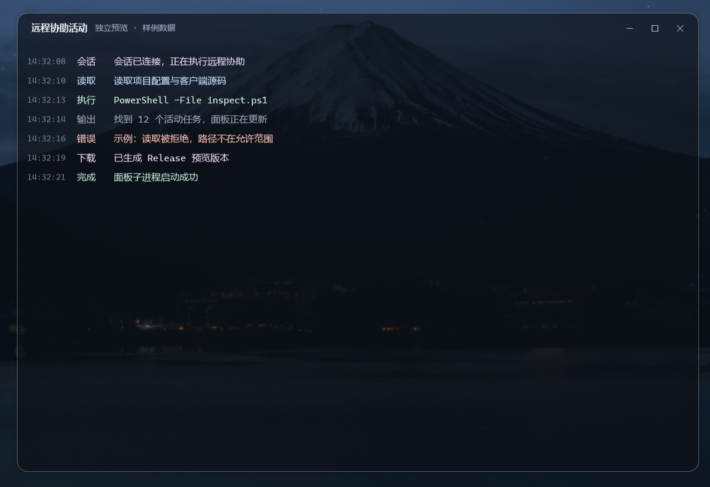

# AgentRemote

让会配置 Agent 的人，直接连上不会用电脑的人的 Windows 设备干活。

设备所有者在客户端点一下生成设备码和临时密码；把这两样交给你，你的 Agent 就能通过 MCP 接管：执行 PowerShell、读写文件、操作桌面。

| 设备端客户端 | 只读活动面板 |
| --- | --- |
|  |  |
| 设备码是公开标识，**临时密码才是凭据** | 协助开始后自动浮现，按操作类型分色，随时可关、不抢焦点 |

## 怎么工作

```text
① 设备端（对方电脑）                ② 操作者侧（我的电脑 / 服务器）
   Yiuk Qt Client                      pi / Claude Desktop / Cursor ...
   生成设备码 + 临时密码                     │ MCP stdio
   主动出站连平台                            ▼
        │                              yiuk-mcp
        │                                  │
        └───────────► Go 平台 ◄────────────┘
                    （中继 + 授权）
```

```text
Agent: request_connection(device_id="123456789", purpose="装打印机驱动",
                          temporary_password="ABCD…")   ← 带密码直接连；不带密码则设备端弹窗审批
平台:  签发 session（绑设备 + 操作者 + 600s 有效期）

Agent: execute_command(session_id, "pnputil /add-driver ...")
平台:  校验归属与权限 → 转发给设备
设备:  执行 PowerShell → 分块回传 stdout / stderr（上限 2 MiB）
Agent: get_command_result(session_id, request_id)
```

也可以把平台和 Agent 一起部署到服务器，接微信机器人用手机发消息遥控。对方装好客户端发来设备码，服务器上的 Agent 自动申请连接、执行并把结果发回去。

## 能力

**授权与会话**

* 9 位十进制设备码仅作寻址；所有权靠设备端生成的 32 字符临时密码（160 bit）
* 带密码直接进；不带密码则设备端弹窗，由所有者批准。批准后平台把当前临时密码回传给操作者，断线重连无需重复弹窗
* 会话绑定设备、操作者与到期时间，关闭会话时同步终止正在运行的任务

**命令与文件**

* `execute_command` / `run_command`：单次 PowerShell 执行，支持工作目录、超时、取消、输出截断；`request_id` 全局幂等，断线不自动重放
* `upload_file` / `download_file`：分块传输，SHA-256 校验，默认拒绝覆盖
* `list_dir` / `stat_path`：列目录与看属性，链接只标注不跟随

**桌面与交互（共 24 个工具）**

* `take_screenshot` / `click` / `move_mouse` / `press_keys` / `type_text`：全屏截图缩放、坐标换算、Unicode 输入或剪贴板投递；截图返回 `screenshot_id`，`click` 绑定时效性与变化检测。抓屏与鼠标操作优先走客户端原生通道，旧客户端自动回退脚本
* `drag`：按住左键沿确定性路径拖动，用于移动窗口、滑块、进度条与拖拽排序；只在确认抬起后才报成功
* `find_on_screen`：用 UIA 在前台窗口里按文本找控件，返回截图坐标与 `screenshot_id`，可直接交给 `click`（图像模板匹配尚未实现）
* `wait` / `wait_for`：本地等待与设备侧条件等待
* `ask_user` / `get_user_reply`：在已授权会话中弹窗询问设备用户，提供单选项并始终允许自由输入，明确区分回复、取消、超时和断线
* 设备可给 `device_id` 或 `device_name`（平台重启后 id 会变，名字更稳）

**只读活动面板**

* 独立子进程 `yiuk-activity-panel`，半透明悬浮终端，按读取 / 执行 / 下载 / 输出 / 错误分色显示

## 安全边界

* 所有操作必须关联有效会话，拒绝、过期或已关闭的会话一律拦截
* 命令以**当前登录用户权限**执行，不做提权
* 临时密码、命令正文和完整输出不落服务端日志；设备端凭证通过 Windows DPAPI 加密保存
* 服务端状态全内存维护，重启后连接、密码、会话与任务全部清空
* 全链路 TLS 1.2+，客户端支持按 SHA-256 指纹固定服务端证书

## 接入

设备端只有 Windows（绿色目录，无安装器）。操作者侧是标准 MCP stdio，任一宿主都能接：

```json
{
  "mcpServers": {
    "yiuk": { "command": "C:/path/to/yiuk-mcp.exe", "args": [] }
  }
}
```

客户端「设置 → Agent 集成 → 复制 Agent 配置」会直接生成这段。

## 文档

* [文档索引](docs/README.md)
* [关键技术约束](docs/key-architecture.md)：不能破坏的不变式、硬上限、未修的已知问题
* [MCP 工具](docs/mcp-tools-improvement-plan.md)：工具清单与使用约束
* [开发与构建](docs/development.md)

## 参与

欢迎 PR / Issue。缺的主要是 **macOS / Linux 客户端**：协议已跨平台，缺设备端实现。
