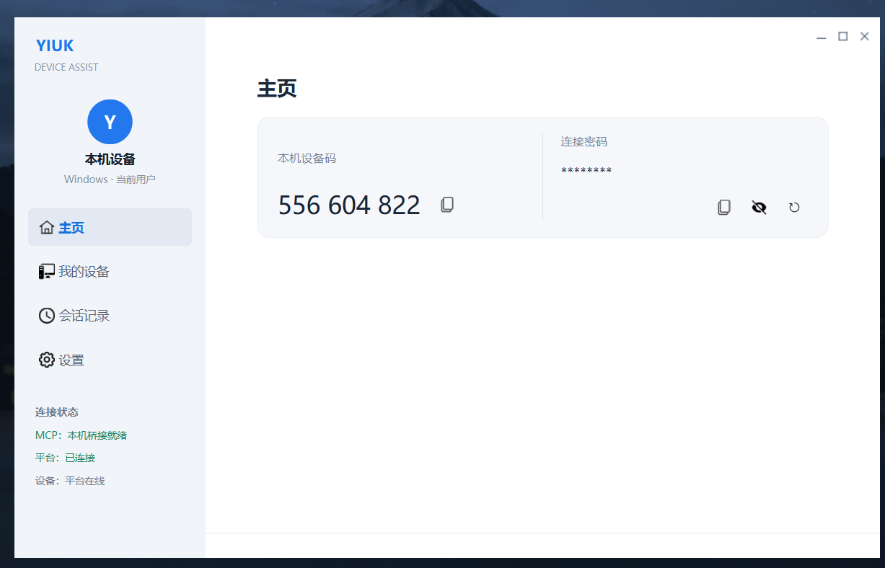

```markdown
# AgentRemote

让会配置 Agent 的人，直接连上不会用电脑的人的 Windows 设备干活。

设备所有者在客户端点一下生成设备码和临时密码，授权后，你的 AI Agent 就能通过 MCP 协议接管执行命令、读写文件和桌面操作。

| 设备端客户端 | 只读活动面板 |
| --- | --- |
|  |  |
| 设备码是公开标识，**临时密码才是凭据** | 协助开始后自动浮现，按操作类型分色，随时可关、不抢焦点 |

> 截图取自独立预览模式（未连平台）。

---

## 为什么做这个

以前在老家县城常帮同学远程修电脑、装软件，后来自己习惯了让 Agent 帮我配环境、查报错，但想给他们也装一套几乎不可能——每台机器都要配 API Key、装运行时、调网络代理，上门搞一次太折腾。

干脆反过来：**把环境全留在我这边，让我的 Agent 直接连他们的电脑。**

和 ToDesk / 向日葵这类远程桌面不同，这里不是让人盯着画面点鼠标：

- **不用配环境**：对面只装一个 Qt 客户端、发来设备码和密码，其余全在操作者这边。
- **返回值给模型读**：输出的是结构化 JSON（`stdout` / `stderr` / `exit_code` 等），不是视频流。
- **按次授权、过程透明**：会话绑定设备、操作者和有效期；所有动作实时打印在设备端悬浮面板上，所有者随时一键断开。

---

## 怎么工作

```text
① 设备端（对方电脑）                ② 操作者侧（我的电脑 / 服务器）
   Yiuk Qt Client                      pi / Claude Desktop / Cursor ...
   生成设备码 + 临时密码                     │ MCP stdio
   主动出站连平台                            ▼
        │                              yiuk-mcp
        │                                  │
        └───────────► Go 平台 ◄────────────┘
                    （中继 + 授权）

```

一次典型调用：

```text
Agent: request_connection(device_id="123456789", purpose="装打印机驱动",
                          temporary_password="ABCD…")   ← 带密码直接连；不带密码则设备端弹窗审批
平台:  签发 session（绑设备 + 操作者 + 600s 有效期）

Agent: execute_command(session_id, "pnputil /add-driver ...")
平台:  校验归属与权限 → 转发给设备
设备:  执行 PowerShell → 分块回传 stdout / stderr（上限 2 MiB）
Agent: get_command_result(session_id, request_id)

```

### 另一种用法：服务器常驻 + 微信遥控

把平台和 Agent 一起部署到服务器，再用 [CLI-WeChat-Bridge](https://github.com/UNLINEARITY/CLI-WeChat-Bridge) 接入微信，出门在外用手机发消息就能远程处理问题：

```text
手机微信 ──► WeChat Bridge ◄──► pi Agent ──MCP──► yiuk-mcp ──► Go 平台 ◄── Qt 客户端

```

对方装好客户端发来设备码，我在微信里发一句“连 123 456 789 帮他装打印机驱动”，服务器上的 Agent 就会自动申请连接、执行并把结果发回微信。同一套部署也顺带管着我自己的服务器更新和配置。

| 微信里下达指令 | Agent 汇报结果 |
| --- | --- |
| | |
| 自动识别在线状态、拆解步骤并确认关键前提 | 排查出旧进程占用 3080 端口及首次下载耗时问题并重写启动脚本 |

---

## 核心能力

**授权与会话**

* 9 位十进制设备码仅作寻址，所有权靠设备端生成的 **32 字符临时密码**（160 bit）验证
* 支持弹窗逐次批准（`approval`）和凭密码直连（`direct`）弹窗批准后平台会把当前临时密码回传给操作者，断线重连无需重复弹窗
* 会话绑定设备、操作者和到期时间，授权范围涵盖命令执行与文件读写，关闭会话时同步终止正在运行的任务

**命令与文件**

* `execute_command` / `run_command`：单次 PowerShell 执行，支持工作目录、超时、取消、输出截断；`request_id` 全局幂等，断线不自动重放
* `read_file`
* `write_file`

**MCP 工具（共 22 个）**

* 包含设备查询、会话控制、命令执行与取消、文件收发，以及基于上述能力组合出的 `take_screenshot`、`click`、`type_text`（支持全屏截图缩放、坐标换算、Unicode 逐字输入或剪贴板投递）。截图返回 `screenshot_id`，`click` 绑定时效性与变化检测；会话与回复查询支持 `wait_seconds` 长轮询。
* `ask_user` / `get_user_reply`：在已授权会话中弹窗询问设备用户，提供单选项并始终允许自由输入；明确区分回复、取消、超时和断线未知结果。见[用户询问说明](docs/user-questions.md)。
* `press_keys` / `move_mouse` / `wait` / `wait_for`：组合键、悬停（读 tooltip、触发 dock）、本地等待与设备侧条件等待，补上 GUI 自动化的基础原语。
* `list_dir` / `stat_path`：列目录与看属性，链接只标注不跟随；错误自带 `hint` 与在线设备现场。
* 设备参数可以给 `device_id` 或 `device_name`（平台内存态重启后 id 会变）；`run_command` 的临时密码改为可选，没有密码就走审批。
* 标准 MCP stdio 接入，支持 pi、Claude Desktop、Cursor 等任意 MCP 宿主。

**只读活动面板**

* 独立子进程 `yiuk-activity-panel`，半透明悬浮终端，按读取、执行、下载、输出、错误分色显示，会话建立后自动弹出

---

## 安全边界

* 所有操作必须关联有效会话，拒绝、过期或已关闭的会话一律拦截
* 命令以**当前登录用户权限**执行，不做提权；普通用户权限依然能改动个人文件和环境，使用时需明确这一点
* 临时密码、命令正文和完整输出不落服务端日志；设备端凭证通过 Windows DPAPI 加密保存
* 服务端状态全内存维护，重启后连接、密码、会话与任务全部清空
* 全链路 TLS 1.2+，客户端支持配置服务端证书指纹固定。

---

## 架构与技术选型

```text
操作者侧 (Windows / Linux 服务器)           设备侧 (Windows)
+----------------------------+             +----------------------------+
| Agent Host (pi / Cursor)   |             | Yiuk Qt Client             |
|   MCP Adapter (stdio)      |             |   审批弹窗 / 会话管理      |
|   Tool Core                |             |   PowerShell / 文件收发    |
|   platformclient (Go)      |             |   只读活动面板             |
+-------------+--------------+             +-------------+--------------+
              | operator (WSS)                           | device (WSS)
              +--------------------+   +-----------------+
                                   v   v
                          +---------------------+
                          | Go 平台服务（中继） |
                          | 认证 / 会话 / 路由  |
                          +---------------------+

```

三条长连接均由客户端主动出站，平台不主动建连，设备在 NAT 或防火墙后也能直接连入。

| 选型 | 原因 | 代价 |
| --- | --- | --- |
| **Go**（平台） | 协程模型适合海量空闲长连接，单二进制部署省事 | 无状态全内存，目前刻意不引入数据库 |
| **Qt**（设备端） | 托盘、高 DPI 悬浮窗等 Windows 桌面体验成熟 | 目前仅支持 Windows，macOS/Linux 需另行实现 |
| **MCP**（接口） | 协议通用，切换 Agent 宿主不用改代码 | 工具 Schema 每轮对话会占一定上下文 token |
| **中心中继** | 规避 NAT 打洞失败率，用户零网络配置 | 流量经中心节点转发，需对帧大小和缓冲设硬上限 |
| **自建协议** | 精确控制分块、幂等键与三态结果语义 | 需自行维护消息顺序与背压控制 |

---

## 项目现状与实测

* **已落地**：Go 平台服务（含 gateway/core 拆分与 Redis 路由登记）、MCP 工具集、Windows Qt 客户端及只读活动面板均已完成，15 个包单元测试全绿，已完成双机 TLS 实测。
* **进行中**：基于 Windows Job Object 的完整进程树清理、安装包升级流程及发布前安全自检。
* **待补齐**：macOS / Linux 设备端（协议已跨平台，目前缺客户端实现）。

实际验证数据：

* **闲鱼试单**：接了 7~8 单（均价 7~8 元），验证陌生人是否愿意授权他人 Agent 操作本机
* **抖音反馈**：相关经历与演示图文获得 9.4 万播放、1.5k 点赞、500+ 收藏
* **过往经验**：此前自研 Qt 工具上架过 Microsoft Store，积累了海内外两三百名真实用户

| 闲鱼接单 | 朋友实测 | 抖音数据 |
| --- | --- | --- |
| | | |
| 陌生人付费实测 | 装完即用 | 9.4 万浏览 / 1567 赞 / 532 收藏 |

---

## 参与与合作

欢迎在以下方向提 PR 或开 Issue：

* **macOS / Linux 客户端**：若有 Qt 或跨平台桌面开发经验欢迎认领
