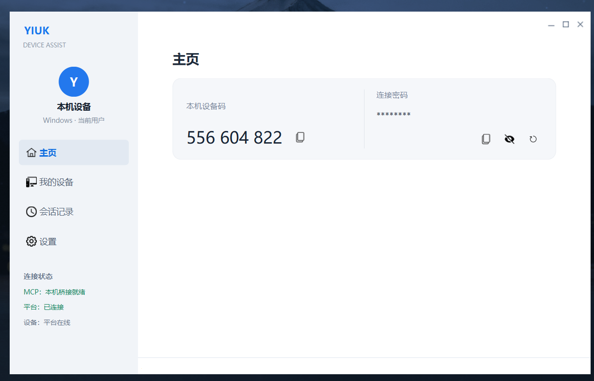
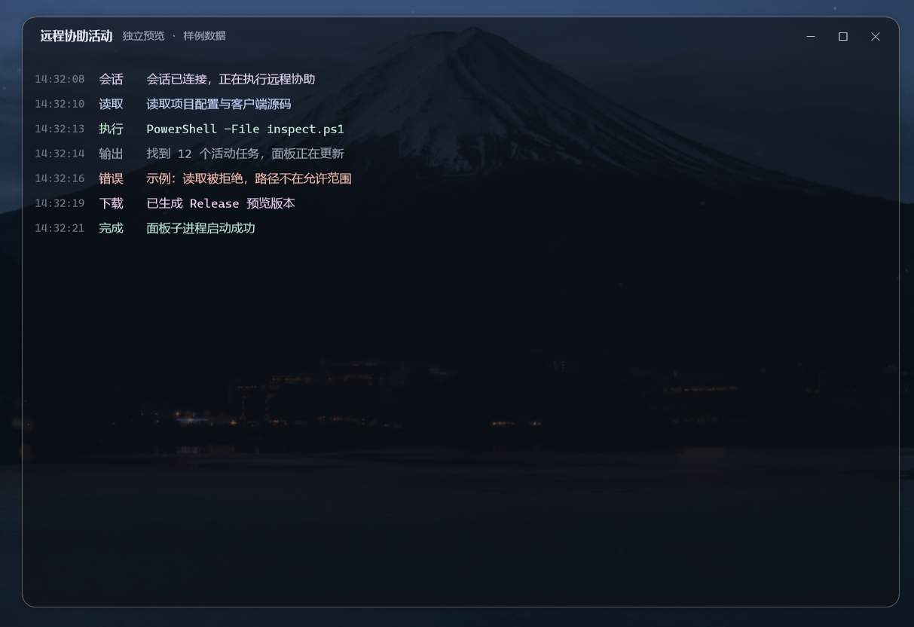
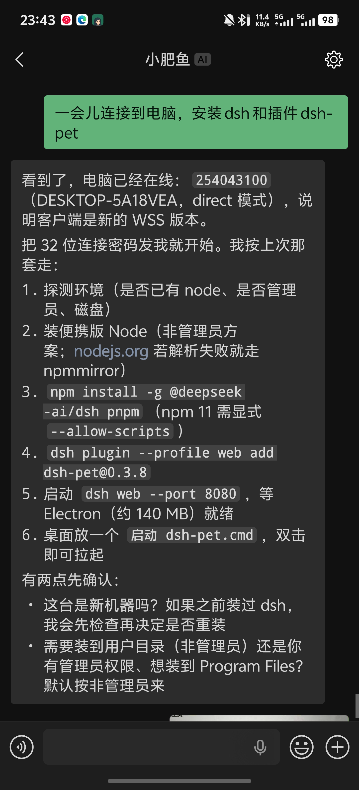
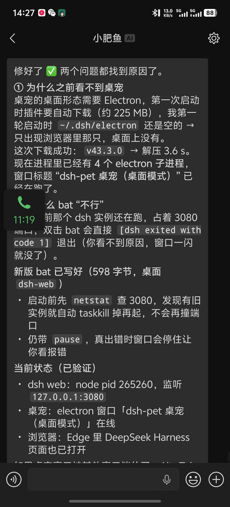
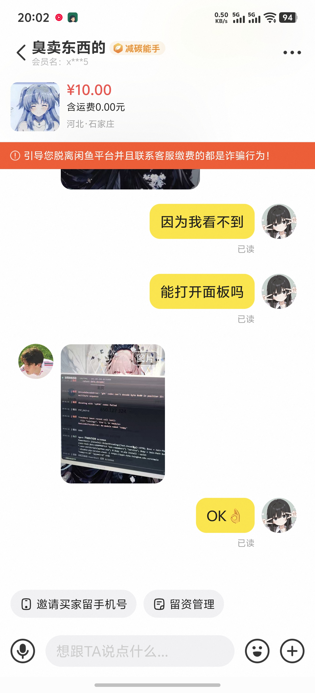
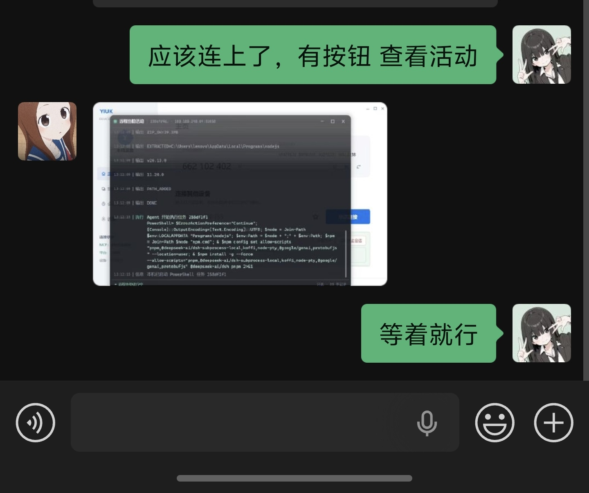

# AgentRemote

**让会配置 Agent 的人，直接帮不会用电脑的人。**

面向 AI Agent 的远程设备协作与执行平台：Agent 在设备所有者授权后，连接并操作远端 Windows 设备

| 设备端客户端 | 只读活动面板 |
| --- | --- |
|  |  |
| 设备码 + 临时连接密码 + 连接状态；设备码是公开标识，**密码才是凭据** | 协助中浮现的半透明悬浮终端，按操作类型分色；随时可关可开，新操作不会把它弹到前台 |

> 左图是设备端的日常形态，右图是协助开始时自动打开的活动面板（截图取自独立预览模式，未连平台）。

---

## 缘起

我高中才开始接触电脑，但接触得早、也爱折腾——带键鼠去学校改机器，因为玩电脑挨过不少罚，也因此在班里成了那个"懂电脑的人"。

小县城里大家摸电脑的机会很少：学校多媒体不让随便碰，很多人到毕业都不会打字、不会中英文切换、不会截屏。靠人缘和爱帮忙，我从毕业起就一直在接各种"电脑问题"：买什么机器、怎么用、蓝屏怎么办、中病毒怎么清、专业软件装不上、系统崩了重装。用得最多的工具是远控软件——经常远程帮同学救机器。

后来这件事做成了小生意：一次 5、10、20 块，电脑美化 + 性能调优这种费时的收到 50。再后来自己做的一款 Qt 客户端上架了 Microsoft Store，全球有两三百个用户。

**之所以做现在这个项目，起因是"我自己先过上了 Agent 的生活，而他们还在原地"。**

我已经习惯让 Agent 帮我配环境、写代码、跑测试、清磁盘、查报错。但我的高中同学还是不会用电脑。想给他们装 Agent？得给他们配 API Key、装运行时、调代理、处理各自不同的网络环境——**每台机器都是一次上门服务，累死也做不完**。

于是想到：既然我自己的 Agent 已经能操作我的电脑，**为什么不让它直接操作别人的电脑？**

我仔细推了一遍——觉得可行，所以就做了

---

## 它解决的三个具体问题

| 传统远程协助 | 本项目 |
| --- | --- |
| 每台机器都要装、配、调（网络环境各不相同） | 设备端只装一个客户端、填个临时密码；**配置全留在会配置的人这边** |
| 人看着屏幕一步步点 | 执行主体是 Agent，结果以结构化 JSON 返回给模型读取 |
| 授权是"整机控制"，没有边界 | 授权是"**这一次**"：会话绑设备 + 操作者 + 有效期，所有者可随时终止 |

### 为什么不是 ToDesk / 向日葵 / TeamViewer

那些产品的执行主体是**人**，形态是"看屏幕 + 点鼠标"。本项目要做的是三件它们目前不提供的事：

1. **无人值守**：设备所有者批准的只是"信任这个人、并在这一次会话的有效期内"，全过程不弹窗、不需要有人在屏幕前。
2. **全过程可见**：每个动作（读取 / 执行 / 下载 / 输出 / 错误）都实时显在设备端的活动面板上，随时能一键终止会话。
3. **返回值是给模型看的**：`{ok, code, stdout, stderr, exit_code, truncated, result_unknown}`——不是像素画面。

---

## 怎么工作？

```text
① 设备端（同学的电脑）          ② 你的 Agent（我的电脑）
   装 Yiuk Qt Client                 pi / Claude Desktop / Cursor ...
   点"生成设备码 + 临时密码"              │ MCP stdio
   主动出站连到平台                      ▼
        │                          yiuk-mcp（你的 MCP Server）
        │                              │
        └──────────► Go 平台 ◄─────────┘
                     （中继 + 授权）
```

一次真实调用：

```text
Agent: request_connection(device_id="123456789", purpose="装一下打印机驱动",
                          temporary_password="ABCD…")   ← 带密码 → 直接连
                                                           不带密码 → 所有者弹窗批准
平台:  签发 session（绑设备 + 操作者 + 600s 到期；批准即授予执行与文件读写）

Agent: execute_command(session_id, "pnputil /add-driver ...")
平台:  校验归属 / 状态 / 权限 → 转发给设备
设备:  执行 PowerShell → 分块回传 stdout / stderr
平台:  按 2 MiB 预算截断 → 缓存 → 结果三态之一
Agent: get_command_result(session_id, request_id) → 拼成人话告诉我
```

**结果只有三种状态**：`succeeded` / `failed` / `result_unknown`。
第三种是刻意保留的——网络断了就是"不知道"，绝不猜成"失败"，因为后者会诱导 Agent 重试一条可能已经执行过的命令。

### 另一种形态：服务器常驻 + 微信遥控（我现在每天在用）

上面那张图里，Agent 跑在我自己的电脑上。但它的**第二个形态更实用**：把平台服务和 Agent 一起部署到服务器，再用 [CLI-WeChat-Bridge](https://github.com/UNLINEARITY/CLI-WeChat-Bridge) 把 pi 接进微信 bot。

```text
手机（微信）                 服务器                                被协助的电脑
  我发消息 ──► WeChat Bridge ◄──► pi Agent ──MCP──► yiuk-mcp          Qt 客户端
  “给他装个打印机”                   │                    │                │
                                     └───► Go 平台服务 ◄──┴────────────────┘
```

于是流程变成：

1. 把安装包发给对方 → 对方装完告我**设备码**；
2. 我在手机上发一句“连 123 456 789 帮他把打印机驱动装上”；
3. 服务器上的 pi 申请连接等待批准 → 执行 → 回来在微信告诉我结果。

**这样一来，人就从电脑前面解放出来了**：无论我在不在电脑前、人在哪里，都能随时开展协助。这是“小县城里每个同学都有一堆电脑问题，而我只有一个人”这个真实约束的解。

同一台服务器上的 Agent 还在承担另一件事：**拉取项目、部署最新版本、管理服务器配置**——运维半自动化

| 在微信里下达指令 | Agent 汇报执行结果 |
| --- | --- |
|  |  |
| Agent 自己发现设备已在线（direct 模式）、列出 6 步执行计划、并反问了两句关键前提（是不是新机器、要不要管理员权限） | 执行完主动汇报根因：Electron 首次启动要下 225 MB、旧实例还占着 3080 端口、重写了带 `netstat` 探测的启动脚本 |

---

## 核心能力

**授权**

- 设备码（9 位十进制）是**公开标识 + 寻址主键**，不是凭据；所有权由设备端生成的 **32 字符临时密码**（160 bit）判定。
- 两种授权路径：逐次批准（`approval`，所有者弹窗）与直接远程（`direct`，持有当前临时密码）。
- 会话绑定设备 + 操作者 + 到期时间，**批准即授予执行命令 / 读文件 / 写文件三项能力**，可即时结束并**终止正在执行的任务**。

**执行**

- 单次 PowerShell 执行，返回 stdout / stderr / 退出码 / 状态 / 截断标记；支持工作目录、超时、取消、输出上限。
- 幂等：`request_id` 全局唯一键，同会话重复提交返回原任务，**断线不自动重放**。

**文件**

- `read_file`：64 KiB 分块，单文件上限 32 MiB，SHA-256 校验后落盘。
- `write_file`：设备端**先写临时文件 → 校验大小与 SHA-256 → 原子改名**；默认拒绝覆盖已有文件。

**Agent 接口**

- 11 个 MCP 工具：`list_devices`、`get_device_status`、`request_connection`、`run_command`、`get_session_status`、`execute_command`、`get_command_result`、`download_file`、`upload_file`、`cancel_command`、`close_session`。
- 标准 MCP stdio 适配器，**不绑定任何 Agent 宿主**——pi、Claude Desktop、Cursor 都能用。

**体验**

- 只读活动面板 `yiuk-activity-panel`：半透明悬浮终端，按操作类型着色（读取 / 执行 / 下载 / 输出 / 错误）。随时可关可开，新操作不会把它弹到前台；会话建立或批准后自动打开（截图见文档开头）。

---

## 安全边界

- 命令只能绑定设备所有者批准的会话；拒绝、过期、关闭的会话一律不执行。
- 命令以**当前登录用户权限**运行，不提升权限——**普通权限不是沙箱**，这一点必须由使用者知道。
- 临时密码、命令正文与完整输出**不写入服务端日志**；设备端凭证使用 Windows DPAPI 保护。
- 服务端完全内存化：重启后在线连接、临时密码、会话与任务全部失效，**不做重启恢复**。
- TLS 端到端（TLS 1.2+），客户端可配置**服务端证书指纹固定**；端口沿用部署配置，不要求 443。

---

## 架构

```text
操作者 Windows / 服务器                    设备所有者 Windows
+--------------------------+               +--------------------------+
| Agent Host (pi 等)        |               | Yiuk Qt Client           |
|   MCP Adapter (stdio)     |               |   所有者审批 / 会话管理  |
|   Tool Core               |               |   PowerShell 执行        |
|   platformclient (Go)     |               |   文件收发 / 活动面板    |
+------------+--------------+               +------------+-------------+
             |  operator 连接 (WSS)                      |  device 连接 (WSS)
             |                                           |
             +-----------------+       +-----------------+
                               v       v
                        +------------------------+
                        | Go 平台服务（中继）    |
                        | 认证 / 设备 / 会话     |
                        | 任务 / 传输 / 路由     |
                        +------------------------+
```

三条长连接**全部由客户端主动出站**，平台从不主动 dial 设备——这是设备能在 NAT / 防火墙后工作的原因。

---

## 技术选型

| 选择 | 理由 | 代价 |
| --- | --- | --- |
| **Go** 写平台 | 一连接两 goroutine，天然适配"大量空闲长连接"；单文件静态部署；本人从 C++ 转 Go | 无成熟 ORM 生态，目前也刻意不用数据库 |
| **Qt** 写设备端 | Windows 原生体验：托盘、悬浮窗、Per-Monitor V2 DPI；本人有 Qt 上架 Microsoft Store 的经验 | 只有 Windows 实现，Mac/Linux 需要另写 |
| **MCP** 作为 Agent 接口 | 协议标准化，不绑定某个 Agent；换宿主不用改一行代码 | 工具描述每轮对话都要消耗 token |
| **中继** 而非 P2P 直连 | 设备只能出站，平台永不 dial；不需要打洞成功率、不需要用户改路由器 | 流量在中心 hairpin，所以所有资源都必须有硬上限 |
| **自建协议** 而非现成框架 | 帧上限、分块、幂等、失败三态都需要精确控制 | 需要自己保证顺序与背压 |

---

## 项目现状

| 能力 | 状态 |
| --- | --- |
| Go 平台服务（认证、设备、会话、任务、TLS 中转、路由） | 已完成 |
| 接入与业务拆分（gateway + core，gRPC 帧透传） | 已完成（P1） |
| Redis 路由登记（网关存活 / 连接归属 / 设备路由） | 已完成（P2） |
| Agent 工具核心与 MCP 适配器 | 已完成 |
| Agent 平台 backend（`platformclient`） | 已完成 |
| Windows Qt 客户端平台对接 | 已完成 |
| Qt ↔ Go 互操作测试 | 已通过 |
| 只读活动面板（独立子进程 / 逐像素透明） | 已完成 |
| 单元测试（15 个包，`go test ./...` 全绿） | 已完成 |
| 端到端冒烟程序（`cmd/smoke`、`cmd/smoke-identity`、`cmd/device-sim`） | 已完成 |
| 真实 Windows 安装包与 TLS 双机验收 | 已完成 |
| 进程树清理（需换 Windows Job Object）、安装升级、发布前安全检查 | 进行中 |
| macOS / Linux 设备端 | 未开始（寻求合作） |

---

## 一些真实数字

- **闲鱼试单**：7~8 单，平均一单 7~8 元——不为赚钱，为验证"陌生人愿不愿意让别人的 Agent 操作自己电脑"。
- **抖音**：把这段经历 + 项目 + 接单截图发出去，9.4 万播放、1.5k 赞、500+ 收藏。
- **此前作品**：自研 Qt 客户端曾上架 Microsoft Store，全球两三百用户，除了中国，还遍及印度、瑞士、美国、乌克兰等国（来自微软开发者后台数据）。

| 闲鱼接单 | 朋友实测 | 抖音 |
| --- | --- | --- |
|  |  |  |
| 陌生人付费试单 | 装完就能用 | 9.4 万浏览 / 1567 赞 / 532 收藏 |

---

## 参与 / 合作

欢迎以下几种方式的参与：

- **macOS / Linux 设备端**：目前只有 Windows 实现，而我身边确实有朋友在使用mac，没有适配导致我必须手动解决。协议已经是平台无关的 JSON，缺的是一个客户端。如果你有 Mac 和 Qt 经验，这是最有价值的缺口。
- **安全评审**：授权模型与失败语义是这个项目的核心，[关键技术架构](docs/key-architecture.md)里列了 10 条**尚未修复**的薄弱点，欢迎直接开 issue 讨论。
- **产品想法**：这个项目起源于"帮身边的人用好电脑"，任何让它对普通人更友好的建议都欢迎。

---

## 文档

- [关键技术架构：决策、不变式与边界](docs/key-architecture.md)：九个关键决策（为什么中继、为什么单写者队列、三层授权、`result_unknown`、资源上限）及其代价，服务端必须保证的不变式，以及尚未修复的薄弱点清单。
- [分布式演进计划](docs/distributed-plan.md)：Gateway 多实例、原有业务整体迁到 Core Service、Redis 路由与共享状态、RabbitMQ 跨网关送帧与用户服务请求/响应；P1（接入/业务分离）与 P2（Redis 路由登记）已落地，P3 起仍是计划。
- [标识符与凭据速查](docs/identifiers.md)：6 个 ID（`device_id` / `connection_id` / `session_id` / `request_id` / `correlation_id` / `password_version`）+ 3 个凭据，分别是谁生成、标识什么、泄露了会怎样。
- [运行时架构：消息转发、MCP 工具与客户端](docs/runtime-architecture.md)：连接拓扑、读写循环、设备/操作者连接绑定、命令去程与结果回程、失败收敛、MCP 工具清单与错误码。
- [Go 后端技术说明与入门指南](docs/go-backend-guide.md)：面向 C++ 后端开发者的 Go 入门、架构、幂等、SHA-256、文件原子落盘和 Docker 说明。
- [开发与构建](docs/development.md)：环境、构建、测试、打包发布、服务器部署（systemd / [Docker](docs/development.md#61-容器部署docker--compose)）。
- [系统串讲：服务器上的 pi Agent 如何操作远端设备](docs/system-walkthrough.md)：后端 / Agent 侧 server / 设备客户端各自是什么、文件归属地图、帧级时序，以及一次真实调用的全流程与错误码对照。
- [本机开发环境](docs/local-dev.md)：**仅限本机**的工具链路径、快捷命令与已知坑。

---

## 开发方式

架构、协议与关键取舍由我确定；编码过程中有 AI 辅助提效，但总体仍由我主导设计与审查，边界、契约和最终实现都由我对结果负责。所以这个项目同时是一次"AI 辅助开发"的实践，也是一个"AI 协作"的产品：**我自己就是它的第一个用户。**

---

> **命名兼容说明：** 当前 Go module / import path 与 MCP server 名称为 `agentremote`。`YIUK_*` 环境变量、`yiuk-platform` 服务/二进制及 `/var/lib/yiuk-platform` 数据目录仍保留旧名称，避免无计划地破坏已有部署、脚本和数据卷；后续如需统一，应配套迁移和兼容步骤。
